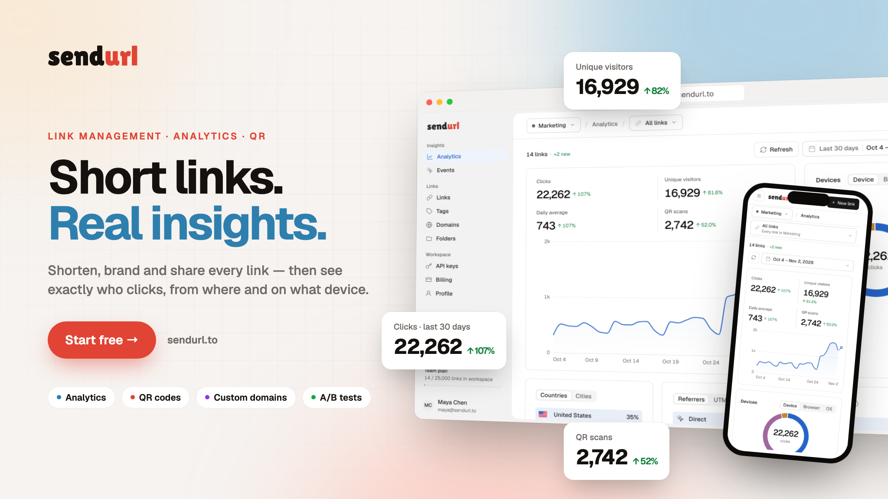
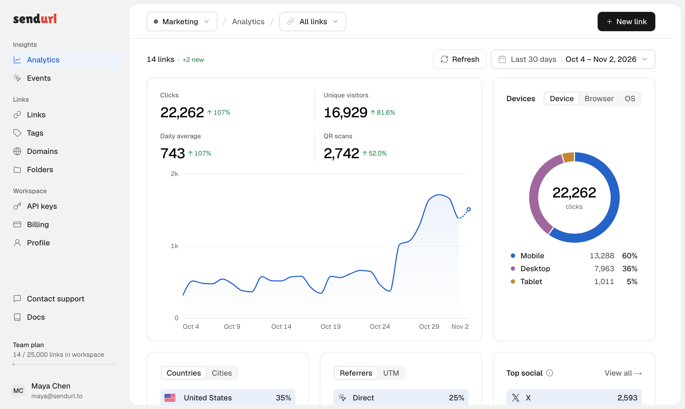
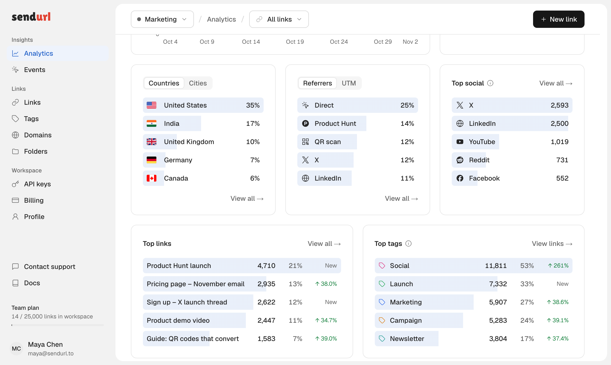
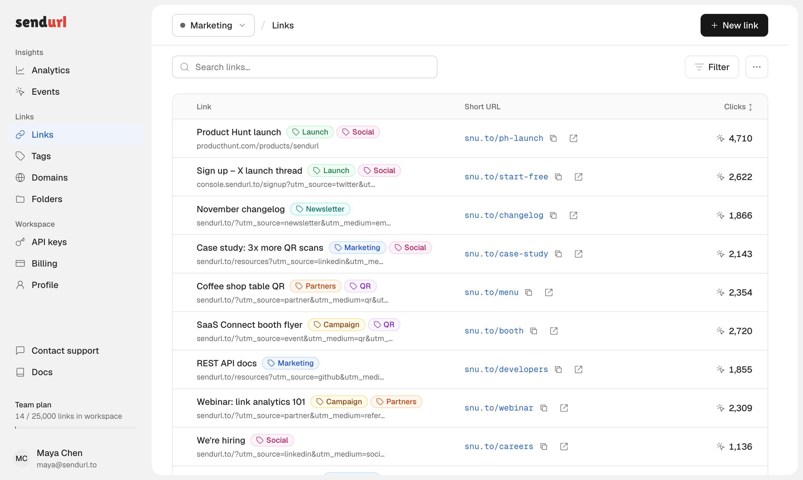
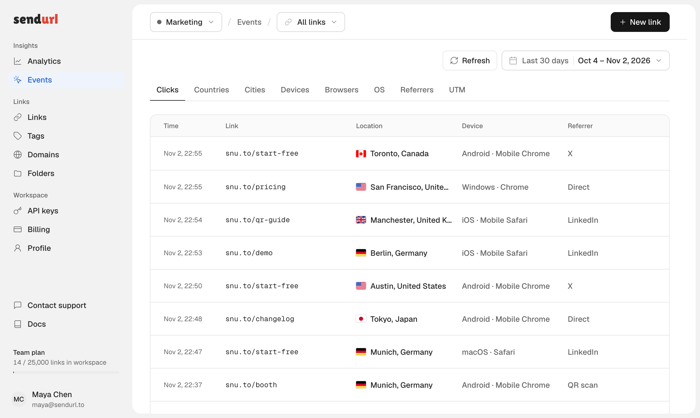
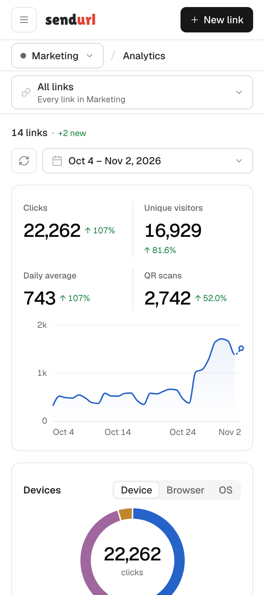
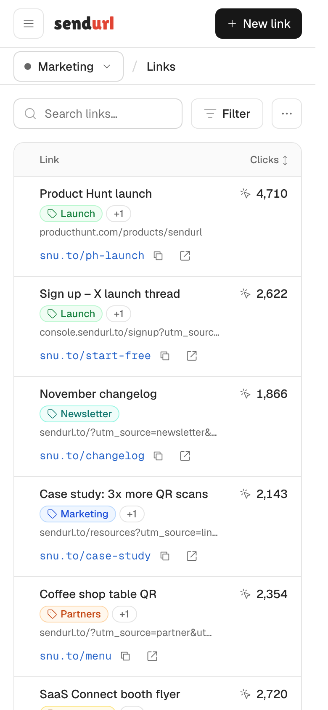

  

# SendURL: free URL shortener with click analytics and QR codes

[SendURL](https://sendurl.to/?utm_source=github&utm_medium=directory) is a free URL shortener and link tracker. Shorten a link, get a QR code for it, and see every click by country, device, browser and referrer, with QR scans counted separately. No ads and no waiting page.

[Try the free URL shortener](https://sendurl.to/free-url-shortener?utm_source=github&utm_medium=directory) · [Sign up free](https://console.sendurl.to/signup?utm_source=github&utm_medium=directory) · [API docs](https://sendurl.to/docs?utm_source=github&utm_medium=directory) · [Pricing](https://sendurl.to/pricing?utm_source=github&utm_medium=directory)

## See it in action

  

   
  <a href="https://www.youtube.com/watch?v=Lq1wiITPx-8">Watch the full demo on YouTube</a>

## What you get

- **Short links** on `snu.to`, a `yourbrand.snu.to` subdomain or your own [custom domain](https://sendurl.to/features/custom-domains?utm_source=github&utm_medium=directory), with random or custom slugs.
- **[Click analytics](https://sendurl.to/features/link-analytics?utm_source=github&utm_medium=directory)**: clicks over time, countries, devices, browsers, operating systems, referrers, top links and tags.
- **[QR codes](https://sendurl.to/features/qr-codes?utm_source=github&utm_medium=directory)** for every link, PNG or SVG, with scans in the same analytics.
- **Folders, tags, UTM builder, A/B tests, mobile app targets and custom link previews.**
- **[REST API](https://sendurl.to/docs?utm_source=github&utm_medium=directory) on every plan**, Free included: create links and read clicks from your code. See the [Python guide](https://sendurl.to/guides/url-shortener-api-python?utm_source=github&utm_medium=directory).
- **Ten [free link tools](https://sendurl.to/tools?utm_source=github&utm_medium=directory)** with no sign-up, including a [UTM builder](https://sendurl.to/tools/utm-builder?utm_source=github&utm_medium=directory), a [QR code generator](https://sendurl.to/tools/qr-code-generator?utm_source=github&utm_medium=directory) and a [redirect checker](https://sendurl.to/tools/redirect-checker?utm_source=github&utm_medium=directory).

## MCP server for AI assistants

Create short links and read their clicks from Claude, ChatGPT, Cursor, VS Code and other MCP clients through SendURL's remote MCP server at `https://api.sendurl.to/mcp`. It is available on every plan, Free included, with nothing to install: sign in with OAuth or use an API key with only the permissions you choose. [How it works](https://sendurl.to/features/mcp?utm_source=github&utm_medium=directory) · [Client configs and docs: sendurl-to/sendurl-mcp](https://github.com/sendurl-to/sendurl-mcp)

## Screenshots

| Click analytics | Countries, devices and referrers |
| --- | --- |
|  |  |
| **All your short links** | **Every click, one by one** |
|  |  |

  
  &nbsp;
  

## Pricing

Free plan: 25 links, 7 days of analytics history, 100,000 visits per link, one custom domain and API keys, no card needed. Paid plans start at $9 a month: [see pricing](https://sendurl.to/pricing?utm_source=github&utm_medium=directory).

---

**SendURL** · [Website](https://sendurl.to/?utm_source=github&utm_medium=directory) · [X](https://x.com/sendurlto) · [LinkedIn](https://www.linkedin.com/company/sendurlto) · hi@sendurl.to
